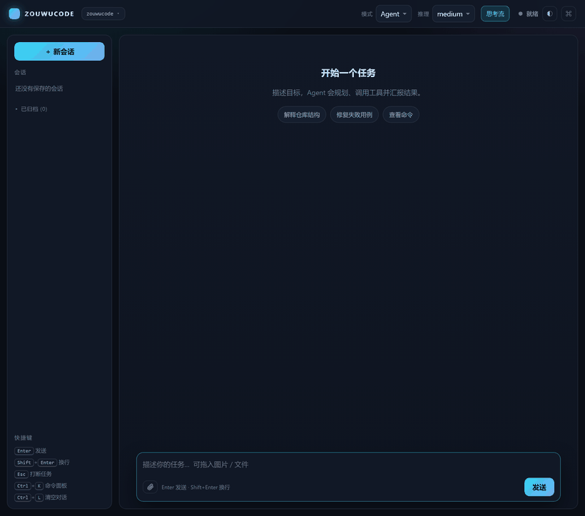

# ZOUWUCODE

**English** | [简体中文](README.zh-CN.md)

> A DeepSeek-native coding agent for your terminal — cache-first, multi-interface, agentic.
>
> Built by [Zouwu Studio](https://github.com/muzizouwu).

[](https://github.com/muzizouwu/zouwucode/releases)
[](https://python.org)
[](LICENSE)
[](tests/)
[](https://github.com/muzizouwu/zouwucode/actions/workflows/ci.yml)



ZOUWUCODE is a terminal-first AI coding agent tuned for DeepSeek. It combines a
cache-first engine (Reasonix-style), multi-mode workflows (Plan / Agent / YOLO),
multi-agent orchestration (Deep Code-style), and Claude Code-inspired architecture —
in one Python package with **four interfaces**: CLI, Textual TUI, browser Web UI, and
a native desktop window.

> Real screenshots:
> [Web UI · English session](docs/assets/webui-en.png) ·
> [Web UI · Chinese session](docs/assets/webui-zh.png) ·
> [Welcome screen](docs/assets/webui-empty.png) ·
> [Download the demo video](docs/assets/demo.mp4)

---

## Highlights

| | |
|---|---|
| **Cache-first engine** | Append-only conversation loop keeps the prompt prefix byte-stable, so DeepSeek's server-side prefix cache keeps hitting (90%+ hit rate in long sessions; cost drops to roughly 1/5). |
| **Four interfaces** | CLI (`zouwucode`), TUI (`--tui`), Web UI (`--web`), desktop GUI (`--gui`, pywebview; falls back to the browser). All share one zero-CDN, zero-build frontend. |
| **Three modes** | Plan (read-only), Agent (interactive approval per tool call), YOLO (autonomous). |
| **12 built-in tools** | read, write, edit, ls, glob, grep, bash, git, web_search, web_fetch, repo_map, python_exec (persistent REPL). |
| **Attachments** | Drop, paste, or pick images/files in the chat (≤5, ≤8 MB each). Uploads are written to `.zouwucode/uploads/` and named in the prompt, so even a text-only model can act on them; vision models also get the image inlined. |
| **Sub-agents** | `task` tool delegates work to isolated sub-agents (own engine/cache, tool allow-list, timeout, cascading interrupt), optionally in separate git worktrees. |
| **Devin-style dev mode** | `zouwucode dev <issue>`: issue → isolated worktree → implement → verify → Draft PR, with planning, layered checks, an independent read-only review, and CI polling. |
| **DeepSeek Harness** | `zouwucode harness "<task>"` hands a task to DeepSeek's official harness (dsh); SDK is optional, with `--doctor`, `--json`, and a friendly fallback. |
| **Evaluation harness** | `zouwucode eval` runs the real agent stack against deterministic task checks — measure scaffolding changes instead of guessing. |
| **Sessions** | Auto-titled, resumable, renameable, forkable, archivable, with per-message rewind (files and/or conversation). |
| **Safety** | Danger-command detection, path allow-lists, optional container isolation, tool-round/timeout/cost circuit breakers, and a unified Esc / Ctrl+C interrupt with resume. |
| **Project memory & rules** | Persistent goals/decisions/state across sessions; `.zouwucode/rules.md` is injected into the system prompt. |
| **Extension layer** | MCP client (stdio + Streamable HTTP) and `zouwucode mcp-serve` to expose your tools; LSP diagnostics, hover, and go-to-definition on demand. |

---

## Quick start

Requires **Python 3.10+** and a [DeepSeek API key](https://platform.deepseek.com/api_keys).

```bash
git clone https://github.com/muzizouwu/zouwucode.git
cd zouwucode
pip install -e .            # add ".[tui]" for the Textual UI, ".[gui]" for the native window
```

Configure the provider:

```bash
zouwucode --init-config     # creates zouwucode_data/config.yaml
```

```yaml
providers:
  deepseek:
    api_key: "sk-your-deepseek-api-key"
    model: "deepseek-flash"
    base_url: "https://api.deepseek.com"
```

Then start an interface:

```bash
zouwucode                   # interactive CLI
zouwucode --tui             # Textual TUI
zouwucode --web             # browser UI on http://127.0.0.1:8080
zouwucode --gui             # native desktop window (same frontend)
python -m zouwucode --web   # if the console script is not on PATH
```

> `config.yaml` contains a secret and is ignored by git. A template lives in
> [config.example.yaml](config.example.yaml). If a key ever leaked, rotate it in the
> DeepSeek console.

---

## Interfaces

| Interface | Command | Notes |
|---|---|---|
| CLI | `zouwucode` | No extra dependencies; slash commands and streaming output. |
| TUI | `zouwucode --tui` | Textual terminal UI with panes, thinking stream, approval dialogs. |
| Web UI | `zouwucode --web` | Three-pane browser UI, SSE streaming, attachment uploads, session management, command palette. |
| Desktop | `zouwucode --gui` | Native window via pywebview; automatically falls back to the browser if unavailable. |

### Modes

| Mode | Switch | Behavior |
|---|---|---|
| Plan | `/plan` | Read-only exploration; no file writes. |
| Agent | `/agent` | Every tool call needs approval (default). |
| YOLO | `/yolo` | Tools run without asking. |

---

## Daily commands

| Command | What it does |
|---|---|
| `/help` `/exit` | Help / quit |
| `/mode` `/reasoning` `/thinking` | Mode, reasoning intensity, thinking stream |
| `/cache` `/context` `/compress` `/usage` | Cache stats, context window, compression, cost |
| `/sessions` `/resume <id>` `/rewind [n]` | Session list, resume, roll back files |
| `/memory` `/goal` `/decide <text>` | Project memory |
| `/rules` `/skill list` | Project rules, skills |
| `/agents` `/oracle <q>` | Sub-agent status, second-opinion review |
| `/share` `/msg` `/inbox` `/peers` | Export session, cross-session messaging |
| `/hello-ultrawork <task>` | Full autonomous pipeline (11 specialist agents) |

---

## Dev mode, harness, and evaluation

```bash
# issue → Draft PR (needs GITHUB_TOKEN with contents:write + pull_requests:write)
zouwucode dev https://github.com/you/repo/issues/42
zouwucode dev "add install notes to the README"   # free-form, local branch only
zouwucode dev --queue <issue-url>                 # queue it
zouwucode dev --workers 3                         # drain the queue in parallel
zouwucode dev --watch you/repo                    # claim `zouwucode:do` issues

# DeepSeek Harness (official dsh); SDK is optional
zouwucode harness "fix the failing test" --doctor
zouwucode harness "explain engine/loop.py" --json

# Evaluation harness: real agent stack, deterministic checks
zouwucode eval
zouwucode eval --list
```

Dev mode is bounded on purpose: `dev/*` branches only, sandboxed to a worktree,
timeouts/cost breakers, and PRs always start as Draft for human review.

---

## Tools

| Tool | Purpose |
|---|---|
| `read` / `write` / `edit` | File access with encoding and line-ending fidelity |
| `ls` / `glob` / `grep` | Navigation and regex search (ripgrep when present, pure-Python fallback) |
| `bash` / `git` | Shell and version control (sandbox-checked) |
| `web_search` / `web_fetch` | Research the web |
| `repo_map` | Ranked signature map of the repository (Aider-style) |
| `python_exec` | Persistent REPL for CodeAct-style actions |
| `task` / `oracle` | Delegate to sub-agents; read-only second opinion |

Tool output is capped (read 2000 lines, bash 30k chars, sub-agent reports 12k chars)
so one runaway call cannot flood the context window.

---

## Architecture

```
zouwucode/
├── engine/          cache-first loop, prefix cache, provider adapters (DeepSeek/OpenAI)
├── tools/           12 built-in tools + registry
├── agent/           coordinator, hooks, sub-agents, oracle
├── session/         persistence, fork/archive, snapshots + rewind
├── context/         memory, topics, transcripts, compression, sliding window
├── sandbox/         permission checks, optional container isolation
├── extensions/      MCP / LSP host
├── dev/             issue → Draft PR pipeline (worktree, verifiers, reviewer, queue)
├── eval/            deterministic task harness
├── harness/         DeepSeek Harness (dsh) adapter
├── webui/           HTTP + SSE server and static frontend
├── tui/             CLI app, Textual app, styles
└── gui.py           native window launcher
```

---

## Web API

`zouwucode --web` also exposes a small local REST surface:

| Endpoint | Method | Purpose |
|---|---|---|
| `/api/status` | GET | Mode, reasoning, busy flag, cache/context stats |
| `/api/chat` | POST | Single turn: `{"message": "...", "attachments": [{"name","mime","data"}]}` |
| `/api/chat/stream` | POST | SSE streaming turn (`thinking` / `content` / `attachments` / `approval_request` / `done` / `interrupted` / `error`) |
| `/api/approve` | POST | Resolve a tool approval (`y` / `a` / `n`) |
| `/api/interrupt` | POST | Interrupt the running task |
| `/api/sessions` · `/api/session/{resume,rename,fork,archive,delete}` | GET/POST | Session lifecycle |
| `/api/workspaces` · `/api/workspace/switch` | GET/POST | Workspace picker |
| `/api/mode` · `/api/reasoning` | POST | Mode and reasoning intensity |

---

## Testing

```bash
python -m pytest -q          # full suite: 783 passed, 1 skipped
python -m pytest tests/ -v   # verbose
```

CI runs the suite on Ubuntu and Windows across Python 3.10 and 3.12.

---

## Documentation

The deep documentation is written in Chinese:

- [Usage guide](USAGE.md)
- [GUI & UI design](docs/GUI与界面设计.md)
- [DeepSeek Harness integration](docs/deepseek-harness接入.md)
- [Dev mode](docs/dev模式使用说明.md) · [Dev mode quick start](docs/dev模式快速上手.md)
- [Sub-agents and extension interfaces](docs/子Agent系统与扩展接口说明.md)
- [Interrupt & resume](docs/打断功能使用说明.md)
- [Evaluation harness](docs/评测harness使用说明.md)
- [Changelog](CHANGELOG.md)

---

## Contributing

Issues and pull requests are welcome. Before sending a PR:

```bash
python -m pytest -q
```

Keep changes focused, add a test for behavior changes, and update `CHANGELOG.md`.
The project follows a "one shared frontend, no CDN, no build step" rule for UI work.

---

## License

MIT — see [LICENSE](LICENSE).

Built by **Zouwu Studio** (走戊工作室).
